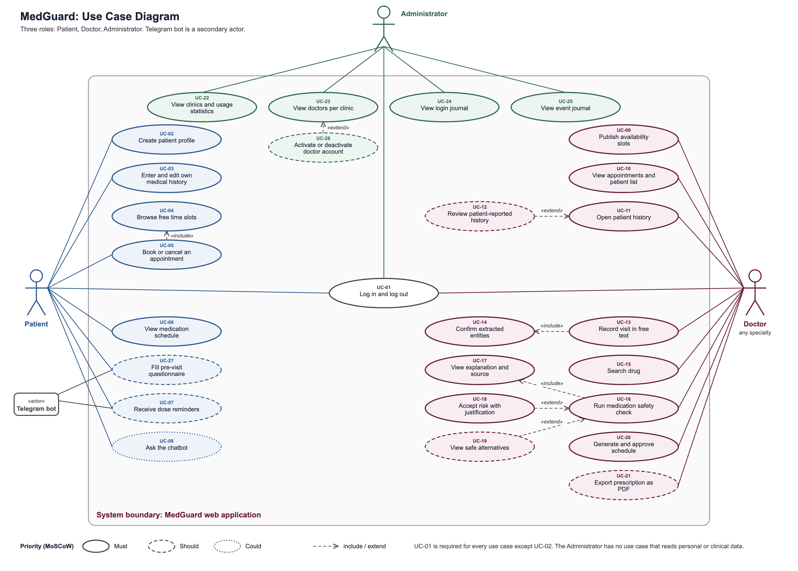

# Use case catalogue

Task: MED-17. Diagram: `diagrams/use-case-diagram.png` (editable source `diagrams/use-case-diagram.puml`, vector `diagrams/use-case-diagram.svg`). Word version: `docs/07-use-case-diagram.docx`.

Actors: Patient, Doctor, Administrator, and the Telegram bot as a secondary actor. UC-01 (log in) is required for every use case except UC-02.

| ID | Use case | Actors | Priority | Description | Precondition |
|---|---|---|---|---|---|
| UC-01 | Log in and log out | Patient, Doctor, Administrator | Must | The user signs in with login and password and is taken to the screen of the own role. The session ends by logout or timeout. | Account exists. |
| UC-02 | Create patient profile | Patient | Must | A person who is not in the database registers and fills the basic profile. Booking is possible only after this step. | None. |
| UC-03 | Enter and edit own medical history | Patient | Must | The patient records past illnesses, chronic conditions, allergies, current medicines and remarks. Entries are labelled patient-reported. | Signed in, profile exists. |
| UC-04 | Browse free time slots | Patient | Must | The patient filters free slots by clinic, specialty, doctor and date. Included by UC-05. | Signed in. |
| UC-05 | Book or cancel an appointment | Patient | Must | The patient picks a free slot and books it; the slot is blocked for others. The patient can cancel, which releases the slot. | Profile exists; free slot exists. |
| UC-06 | View medication schedule | Patient | Must | The patient sees the approved schedule and active prescriptions. | Doctor approved a schedule. |
| UC-07 | Receive dose reminders | Patient, Telegram bot | Should | The system sends reminders through Telegram; the patient marks doses as taken or skipped. | Patient linked a Telegram account. |
| UC-08 | Ask the chatbot | Patient | Could | The patient asks about the own schedule or general medicine information; the bot refuses diagnosis requests. | Signed in. |
| UC-09 | Publish availability slots | Doctor | Must | The doctor of any specialty creates, edits and removes free time slots. | Signed in. |
| UC-10 | View appointments and patient list | Doctor | Must | The doctor sees booked appointments, searches the patient list and filters by status. | Signed in. |
| UC-11 | Open patient history | Doctor | Must | The doctor opens conditions, allergies, medicines, visits and patient-reported remarks of a patient at the appointment. | Patient belongs to the doctor's clinic. |
| UC-12 | Review patient-reported history | Doctor | Should | The doctor confirms, corrects or rejects entries made by the patient. Extends UC-11. | UC-11 is open. |
| UC-13 | Record visit in free text | Doctor | Must | The doctor writes the visit note; the system proposes structured entities. Includes UC-14. | UC-11 is open. |
| UC-14 | Confirm extracted entities | Doctor | Must | The doctor confirms, edits or rejects each extracted condition, allergy and medicine before it is used. Included by UC-13. | Extraction ran. |
| UC-15 | Search drug | Doctor | Must | The doctor searches a drug by brand or generic name and sees the active substance and label data. | Signed in. |
| UC-16 | Run medication safety check | Doctor | Must | The doctor enters a proposed medicine; the system checks interactions, allergy, contraindication, duplicate therapy and dose, and shows alerts by level. Includes UC-17. | UC-11 is open; entities confirmed. |
| UC-17 | View explanation and source | Doctor | Must | For each alert the doctor sees reason, patient factor, recommended action and the source with version. Included by UC-16. | Alert exists. |
| UC-18 | Accept risk with justification | Doctor | Must | The doctor accepts a flagged risk and enters a mandatory comment. Extends UC-16. | Alert exists. |
| UC-19 | View safe alternatives | Doctor | Should | The system offers one or two safer alternatives with justification. Extends UC-16. | Critical or review alert exists. |
| UC-20 | Generate and approve schedule | Doctor | Must | The system builds a dosing schedule from the approved regimen; the doctor edits and approves it, after a repeat check. | Regimen decided. |
| UC-21 | Export prescription as PDF | Doctor | Should | The doctor exports the prescription and schedule for printing. | Schedule approved. |
| UC-22 | View clinics and usage statistics | Administrator | Must | The administrator sees the number of clinics, doctors and active users. No personal data. | Signed in. |
| UC-23 | View doctors per clinic | Administrator | Must | The administrator sees clinics and their doctors with specialty and status. | Signed in. |
| UC-24 | View login journal | Administrator | Must | The administrator sees login times, pseudonymous user IDs, roles and results; filters and exports. | Signed in. |
| UC-25 | View event journal | Administrator | Must | The administrator sees the audit events without clinical content. | Signed in. |
| UC-26 | Activate or deactivate doctor account | Administrator | Should | The administrator switches a doctor account on or off. Extends UC-23. | UC-23 is open. |
| UC-27 | Fill pre-visit questionnaire | Patient, Telegram bot | Should | Before the appointment the patient answers questions about complaints in the application or in the bot; the doctor sees the answers in the visit record. | Booking exists. |

Relations: UC-05 includes UC-04; UC-13 includes UC-14; UC-16 includes UC-17; UC-12 extends UC-11; UC-18 and UC-19 extend UC-16; UC-26 extends UC-23.
